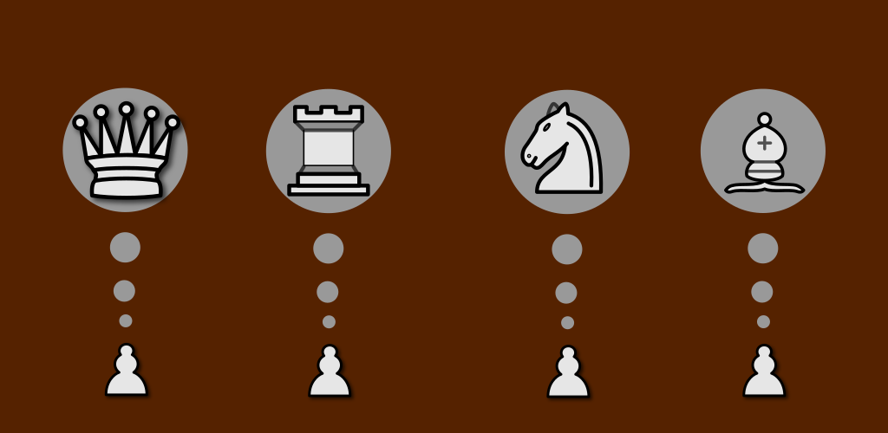
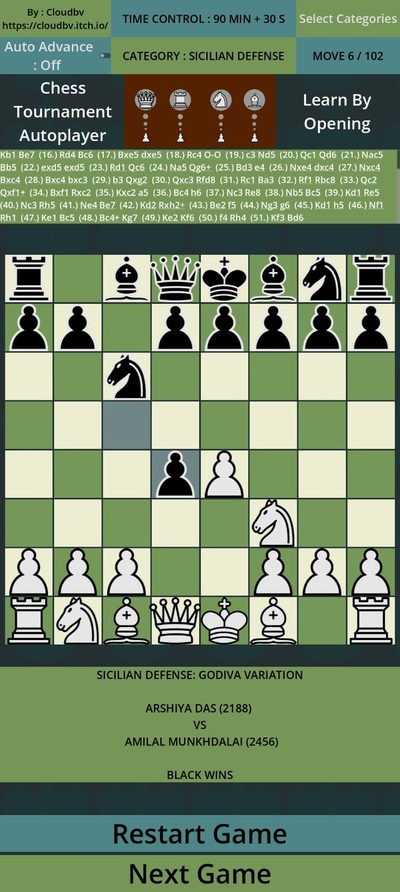
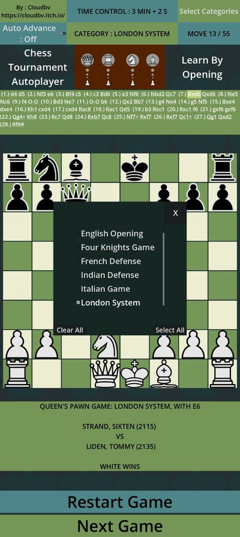
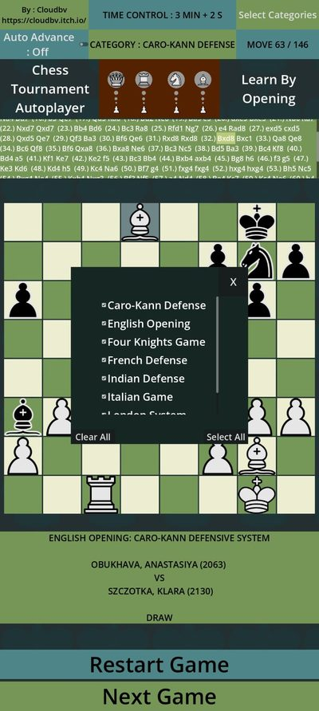
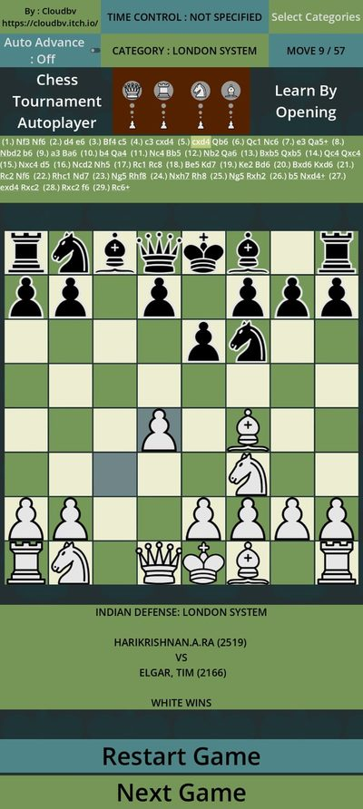

  

# Chess Tournament Autoplayer

Learn chess openings by watching real games play out. The app replays real Lichess games move by move on an animated board, grouped by opening, so the same ideas show up again and again.

**[Get it on Google Play](https://play.google.com/store/apps/details?id=com.cloudbv.chesstournamentautoplay)** · **[Visit the website](https://cloudbv.github.io/-Project-Chess-Tournament-Autoplay/)**

Built with Godot 4 and GDScript.

  
  
  
  

## Features

- Games play themselves one move at a time, showing both players, their ratings and the result.
- Pick from eight openings: Caro-Kann Defense, English Opening, Four Knights Game, French Defense, Indian Defense, Italian Game, London System and Sicilian Defense.
- Filter games by time control instead of by opening.
- Auto Advance starts the next game when the current one ends.
- Tap any move in the move list to jump to that position.
- Restart Game and Next Game buttons. On desktop, Space loads the next game.
- On Android, the back button closes the settings menu when it is open.

## How it works

1. **Cleaning the data.** Raw Lichess exports are huge multi-game PGN files. A small Python and Tkinter tool, built on python-chess, filters them by opening, ECO code, Elo, player, result and time control. It writes each game as a short cleaned `.txt` file, sorted into one folder per opening.
2. **Reading the moves.** `pgn_parser.gd` loads a game's headers and splits the movetext into move tokens. For each move it works out which piece moved by scanning the board from the destination square. It handles knights, sliding pieces, kings, pawn pushes and captures, castling, en passant and promotion.
3. **Drawing the board.** `chess_board.gd` builds the board from 64 square scenes with a piece on top. Moves slide into place with a tween and the last move is highlighted. Jumping to a move skips the animation and rebuilds the position instantly.

The parser replays games that already happened, so it does not check move legality or detect check.

## Code

| File | What it does |
| --- | --- |
| `main.gd` | Game loop, filters, autoplay |
| `chess_board.gd` | Board state, move animation, castling, en passant, promotion |
| `pgn_parser.gd` | Game loading, move tokenizing, origin search |
| `ui.gd` | Signals, menus, move list panel |
| `square.gd` | Square colors and move highlight |
| `piece.gd` | Piece type, color and sprite |

## Credits

Made by Cloudbv. More projects on [itch.io](https://cloudbv.itch.io).
